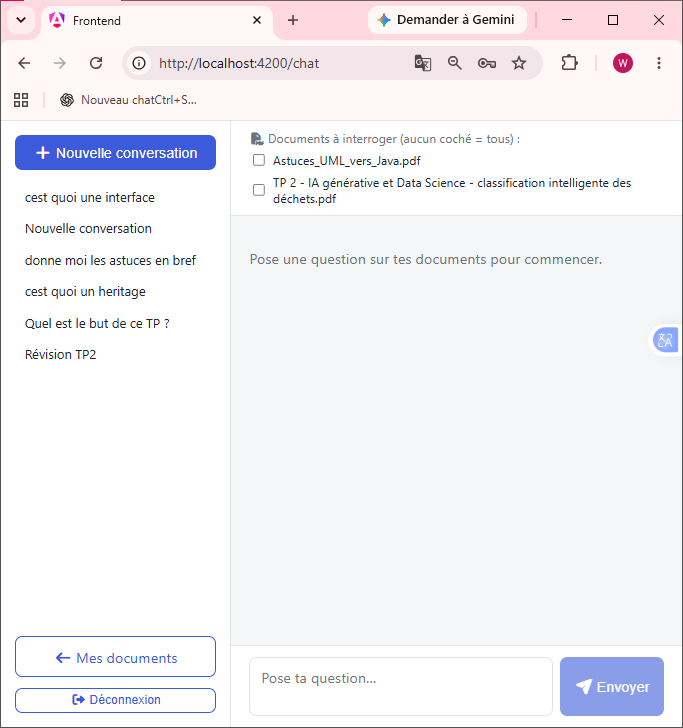
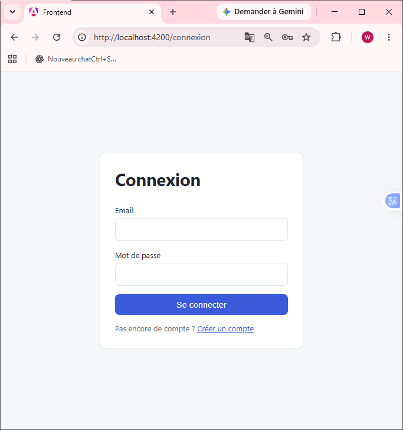
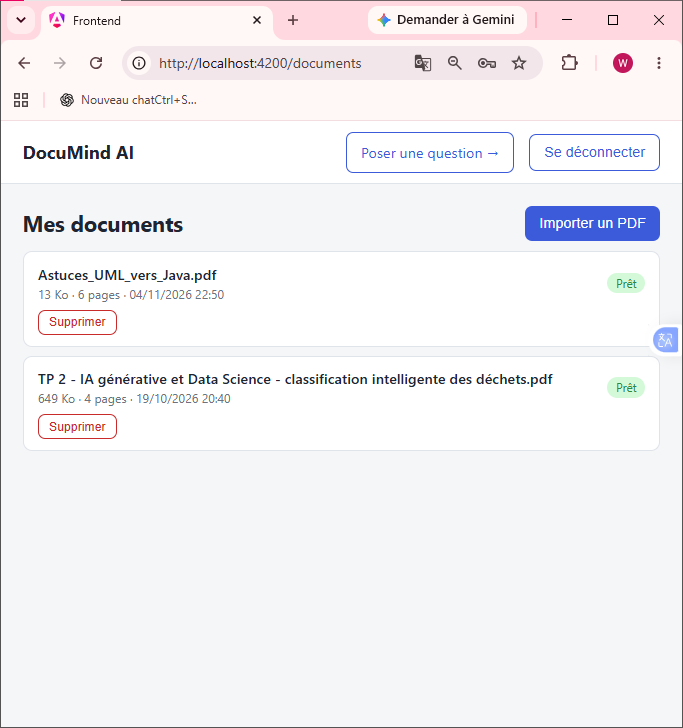
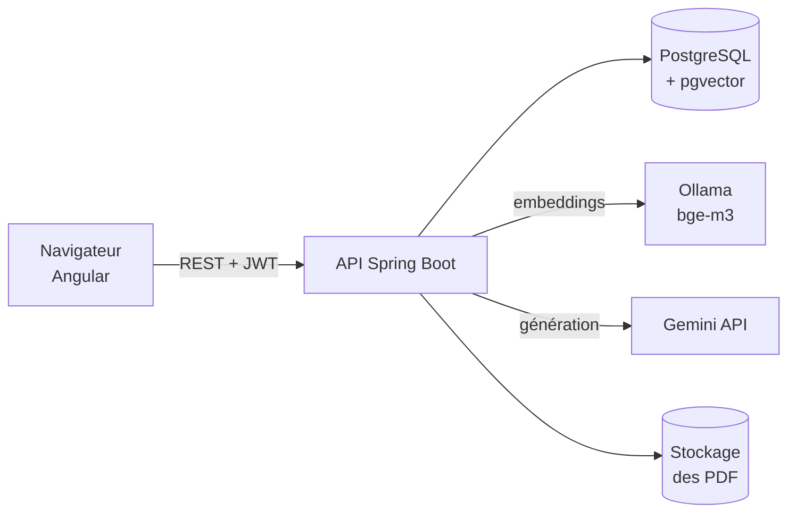
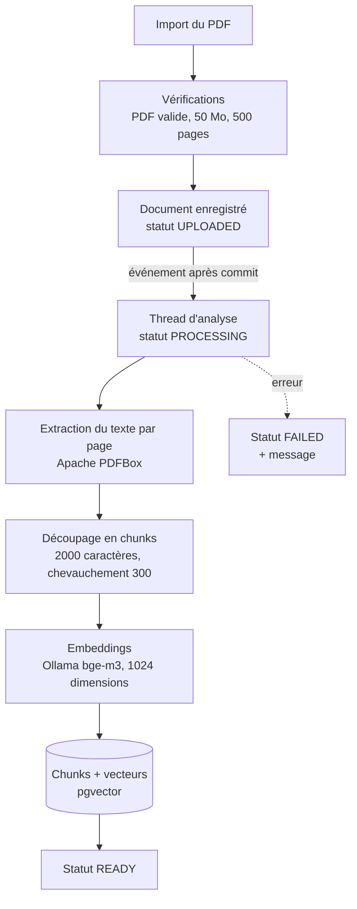
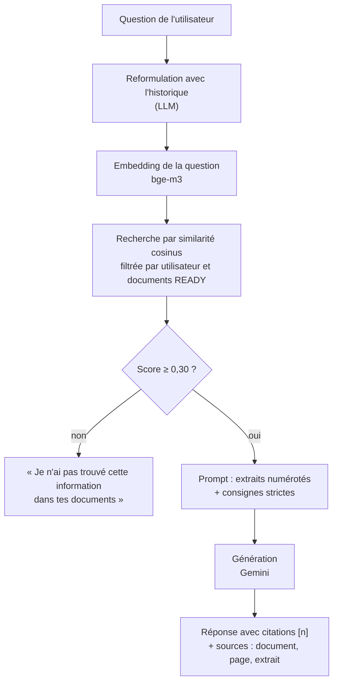

# DocuMind AI

Application web full-stack pour **importer des PDF et les interroger en langage naturel**. Les réponses sont générées à partir des extraits de tes documents (RAG) et **citent leurs sources** (document, page, extrait), pour pouvoir tout vérifier.

> Projet personnel : Angular · Spring Boot · PostgreSQL + pgvector · Ollama (embeddings) · Gemini (génération)



## Fonctionnalités

- Inscription et connexion (JWT, mots de passe hachés avec BCrypt)
- Import de PDF (50 Mo, 500 pages max) avec **analyse en arrière-plan** : `En attente → Analyse en cours → Prêt / Échec`
- Relance d'une analyse échouée, suppression d'un document
- Questions en langage naturel avec réponses **sourcées** (`[1]`, `[2]`… + document, page, extrait)
- Conversations avec historique, renommage, suppression
- **Choix des documents à interroger** à la création d'une conversation (ou tous par défaut)
- Réponses rendues en markdown
- Isolation stricte entre utilisateurs : chacun ne voit et n'interroge que ses propres documents

| Connexion | Mes documents |
|---|---|
|  |  |

## Architecture



### 1. Import et analyse d'un PDF

L'import répond tout de suite ; l'analyse se fait en arrière-plan (un seul thread, les PDF sont traités un par un).



### 2. Question et réponse (RAG)



### Choix techniques

| Choix | Pourquoi |
|---|---|
| **bge-m3** (Ollama) pour les embeddings | Testé contre nomic-embed-text, qui séparait mal les concepts en français. bge-m3 est multilingue, 1024 dimensions, et tourne en local sans GPU. |
| **pgvector** + index HNSW (cosinus) | Une seule base pour les données et les vecteurs, avec filtrage par utilisateur en SQL. |
| **Seuil de similarité 0,30** | Mesuré sur mes documents : extraits pertinents entre 0,48 et 0,63, hors-sujet autour de 0,27. En dessous du seuil, on ne sollicite même pas le LLM. |
| **Consigne anti-hallucination** | Le LLM ne répond qu'à partir des extraits, cite `[n]`, répond « information absente » sinon, et ignore toute instruction contenue dans un extrait (injection de prompt). |
| **Analyse asynchrone** | Embeddings lents sans GPU : l'API répond immédiatement, le front suit le statut par polling. |
| **Reprise au démarrage** | Un document resté `UPLOADED`/`PROCESSING` après un arrêt est marqué `FAILED` et peut être relancé. |
| **Fournisseur LLM interchangeable** | Interface `LlmProvider` : Gemini aujourd'hui, un autre fournisseur en changeant une propriété. Modèle de secours automatique et nouvelles tentatives sur 429/503. |
| **404 plutôt que 403** | Un document ou une conversation d'un autre utilisateur est indiscernable d'un élément inexistant. |

## Stack

| Couche | Technologies |
|---|---|
| Frontend | Angular 22 (composants standalone, signaux), `marked` (markdown), Font Awesome |
| Backend | Java 21, Spring Boot, Spring Security + JWT, JPA/Hibernate, Flyway, Lombok, Apache PDFBox |
| Base de données | PostgreSQL + pgvector (Docker) |
| IA | Ollama (bge-m3) pour les embeddings, API Gemini pour la génération |
| Tests | JUnit 5, Mockito |

## Prérequis

- Java 21
- Node.js 24 et npm (Angular CLI 22 : `npm install -g @angular/cli`)
- Docker Desktop
- [Ollama](https://ollama.com)
- Une clé API Gemini : https://aistudio.google.com/apikey

## Installation et lancement

### 1. Cloner et configurer

```powershell
git clone https://github.com/wissalhattach-glitch/documind.git
cd documind
copy .env.example .env
```

Édite `.env` et remplis les 4 variables. Pour générer un `JWT_SECRET` aléatoire (PowerShell) :

```powershell
$b = New-Object byte[] 48; [Security.Cryptography.RandomNumberGenerator]::Create().GetBytes($b); [Convert]::ToBase64String($b)
```

### 2. Base de données

```powershell
docker compose up -d
```

Les migrations Flyway créent les tables au premier démarrage du backend.

### 3. Ollama (embeddings)

```powershell
ollama pull bge-m3
```

Ollama doit tourner (http://localhost:11434 affiche « Ollama is running »).

### 4. Backend

```powershell
cd backend
.\mvnw.cmd spring-boot:run
```

L'API écoute sur http://localhost:8080. Les PDF sont stockés dans `backend/storage/`.

### 5. Frontend

```powershell
cd frontend
npm install
ng serve
```

Ouvre http://localhost:4200, crée un compte, importe un PDF, attends le statut **Prêt**, puis pose une question dans le chat.

> Sans GPU, l'analyse d'un PDF de 35 pages prend plusieurs minutes (embeddings sur CPU).

## Configuration

Dans `backend/src/main/resources/application.properties` :

| Propriété | Défaut | Rôle |
|---|---|---|
| `app.upload.max-pages` | 500 | Pages maximum par PDF |
| `app.embedding.model` | bge-m3 | Modèle d'embeddings Ollama |
| `app.search.min-score` | 0.30 | Score minimal pour considérer un extrait pertinent |
| `app.llm.provider` | gemini | Fournisseur de génération |
| `app.llm.gemini.model` | gemini-3.5-flash-lite | Modèle Gemini principal |
| `app.llm.gemini.fallback-model` | gemini-flash-lite-latest | Modèle de secours |
| `app.cors.allowed-origins` | http://localhost:4200 | Origines autorisées (CORS) |
| `jwt.expiration-ms` | 3600000 | Durée de vie du token (1 h) |

## API

Toutes les routes, sauf `register` et `login`, demandent l'en-tête `Authorization: Bearer <token>`.

| Méthode | Route | Description |
|---|---|---|
| POST | `/api/auth/register` | Créer un compte |
| POST | `/api/auth/login` | Se connecter (retourne le token JWT) |
| POST | `/api/documents` | Importer un PDF (multipart, champ `fichier`) |
| GET | `/api/documents` | Lister ses documents (paginé) |
| GET | `/api/documents/{id}` | Détail et statut d'un document |
| POST | `/api/documents/{id}/traitement` | Relancer l'analyse (202, suivre le statut avec GET) |
| DELETE | `/api/documents/{id}` | Supprimer un document |
| POST | `/api/conversations` | Créer une conversation (`documentIds` optionnel) |
| GET | `/api/conversations` | Lister ses conversations |
| GET | `/api/conversations/{id}` | Détail : messages et sources |
| PATCH | `/api/conversations/{id}` | Renommer |
| DELETE | `/api/conversations/{id}` | Supprimer |
| POST | `/api/conversations/{id}/messages` | Poser une question dans une conversation |
| POST | `/api/questions` | Question isolée (sans conversation) |
| POST | `/api/recherche` | Recherche sémantique brute (extraits et scores) |

Erreurs : corps JSON `{ "status": 409, "code": "PROCESSING_IN_PROGRESS", "message": "..." }`.

## Tests

```powershell
cd backend
.\mvnw.cmd test
```

- Extraction PDF, découpage en chunks, logique RAG (Mockito)
- Test des embeddings : ignoré automatiquement si Ollama n'est pas lancé
- Test Gemini : lit `GEMINI_API_KEY` (variable d'environnement ou `.env`)

## Sécurité

- Mots de passe hachés (BCrypt), tokens JWT signés (HS256), sessions sans état
- Isolation par utilisateur appliquée dans chaque requête SQL (documents, chunks, conversations)
- Validation des PDF par signature (`%PDF-`), limites de taille, de pages et de mots
- Secrets uniquement dans `.env` (ignoré par Git), jamais dans le code
- Réponses du LLM restreintes aux extraits fournis ; instructions cachées dans un PDF ignorées
- HTML des réponses nettoyé par Angular avant affichage

## Limites connues

- Les PDF scannés (images) ne sont pas supportés : pas d'OCR
- Embeddings sur CPU : l'analyse de gros documents est lente
- Quota et disponibilité de l'API Gemini gratuite variables (nouvelles tentatives et modèle de secours prévus)
- Le token JWT dure 1 h, sans rafraîchissement
- Les documents d'une conversation ne sont pas modifiables après sa création

## Pistes d'évolution

- Réponses en streaming (SSE)
- Citations `[n]` cliquables reliées aux sources
- OCR pour les PDF scannés
- Limitation du nombre de requêtes (rate limiting) sur la connexion et les questions
- Docker Compose complet (base, backend, frontend)
- Tests d'intégration avec une vraie base